# 0. What is Portal?

Imagine a policy trying to pick up a cube. It misses, so you take control,
correct the motion, and let it try again. Recording those corrections gives
you new demonstrations to train on. That is the human-in-the-loop cycle we’ll
build here.

Portal connects the robot, human operator, policy, and recorder through a
LiveKit room. They can run on different machines. You supply the hardware and
model code; Portal carries observations and actions and decides which operator
may control the robot.

## Three roles, four processes

| Process | Portal role | What it does |
|---|---|---|
| `uv run robot` | Robot | Publishes joint state and three camera feeds; applies accepted actions |
| `uv run teleoperator` | Operator | Reads both leader arms and lets you switch control |
| `uv run dream-1` or `uv run act` | Operator | Produces actions from observations |
| `uv run recorder` | Observer | Records streams and episode markers without driving |

<picture>
  <source media="(prefers-color-scheme: dark)" srcset="images/hitl-room-dark.svg">
  
</picture>

[Chapter 10](10-voice-tasks.md) adds `uv run dream-1-tasks`, a Dream-1 whose
task can change while it runs, and a voice agent that changes the task and who
drives. The voice agent is not a Portal peer: it asks Dream-1 over RPC.
[Chapter 12](12-task-monitor.md) adds a task monitor, an observer that judges
from the overhead camera when Dream-1's task is done or stuck, pauses it, and
tells the voice agent.

The human and policy use the same operator interface. The robot accepts actions
from one active operator at a time. Pressing `c` in teleop changes that operator;
you can switch during a take while the recorder continues writing.

## Words used in this tutorial

- **Leader:** an arm you move by hand. **Follower:** an arm that executes commands.
- **Operator:** a process that proposes actions, either from the leaders or a policy.
- **Policy:** a model that turns observations into actions.
- **Active operator:** the one operator whose actions the robot accepts.
- **Take / episode:** one recorded attempt at a task.
- **Checkpoint:** saved model files produced by training.

## Start here

1. [Set up the rig and check human control](01-first-recording.md).
2. [Run Dream-1 and record your corrections](02-dream-1.md).
3. [Train ACT on the corrected takes](03-train-act.md), then collect more corrections.
4. Optionally, [steer Dream-1 by voice](10-voice-tasks.md), and
   [let a task monitor pause it when it is done or stuck](12-task-monitor.md).

Human-only demonstrations are an [alternative](09-reference.md#human-only-demonstrations).
Chapters 4–8 explain the code; chapter 9 is the settings reference.

---

[Tutorial index](../README.md#the-tutorial) · Next: [1. Set up the rig](01-first-recording.md)
