# 6. Operator loop

Open [`src/teleoperator.py`](../src/teleoperator.py).
The human operator receives video, reads both leader arms, and sends one action
per tick. It also controls handoff and marks episode boundaries.

## 1. Receive camera frames

Each declared track registers an `on_video_frame` callback. The callback updates
`View` with the frame timestamp and passes decoded RGB pixels to `Preview`:

```python
view.saw(name, frame)
preview.show(name, frame_bytes_to_numpy_rgb(frame.data, frame.width, frame.height))
```

The preview keeps the latest image per camera.

## 2. Send an anchored action

```python
if action := await hardware.run(leaders.get_action):
    op.send_action(action, in_reply_to_ts_us=view.anchor())
```

`View.anchor()` is the oldest of the latest camera timestamps, so it follows the
slowest of the three views; it does not make their capture times simultaneous. It returns
`None` until all cameras have produced a frame.

<picture>
  <source media="(prefers-color-scheme: dark)" srcset="images/action-anchor-dark.svg">
  
</picture>

The anchor identifies the view available to the human. Using the latest state
timestamp instead could select state that arrived before its matching video.
Portal separately stamps when the action was sent using its robot-synchronized
clock.

## 3. Select the active operator

Press `c` to claim control. Press it again to cycle to another connected
operator, such as `policy-act`. With only teleop connected, `c` selects teleop.
There is no background loop that reclaims the gate after you hand it away.

The leaders keep publishing while the policy drives, but the robot accepts
human actions only while the human is selected.

## 4. Mark a take

The walkthrough sets one task through `PORTAL_DATA_TASKS`. Without that setting,
teleop prompts for task descriptions at startup. The hotkeys are:

| Key | Action |
|---|---|
| `c` | Claim or cycle control |
| `p` | Park the followers (walk to rest, switch off); again to power them up |
| `r` | Start or end a take |
| `[` | Discard the current take |
| `1`–`9` | Switch tasks between takes |
| `x` | Quit, discarding an open take |

Keys work globally where desktop permissions allow, and in the teleoperator’s
terminal as a fallback. Start the recorder before marking a take. A
`NOT RECORDED` message means the marker did not reach an observer.

---

Previous: [5. Robot loop](05-robot-loop.md) · [Tutorial index](../README.md#the-tutorial) · Next: [7. HITL recording](07-hitl-recording.md)
